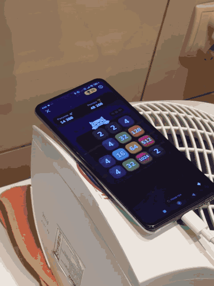
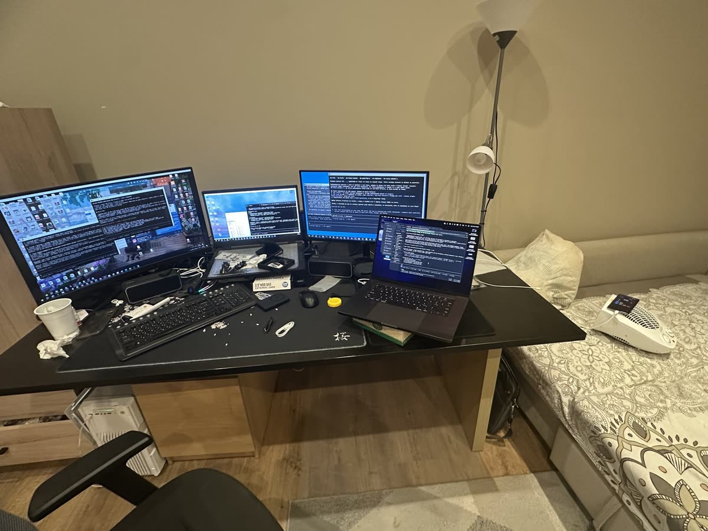
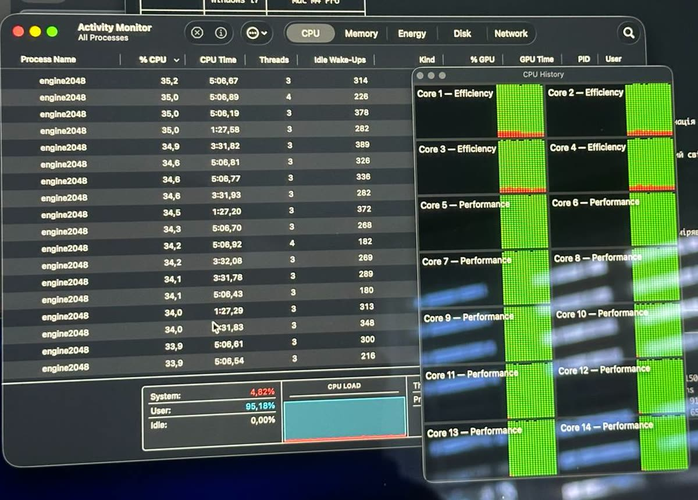
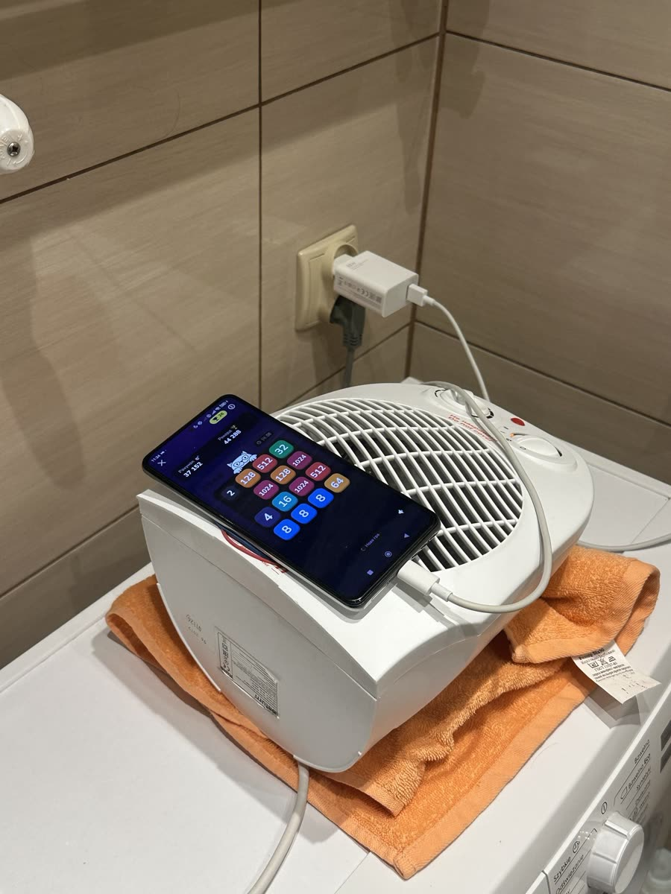
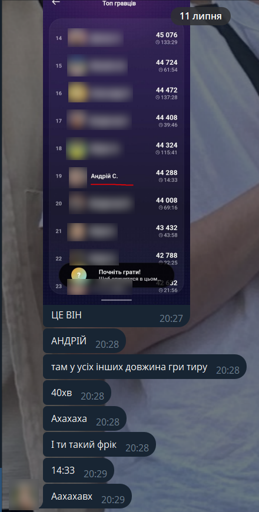
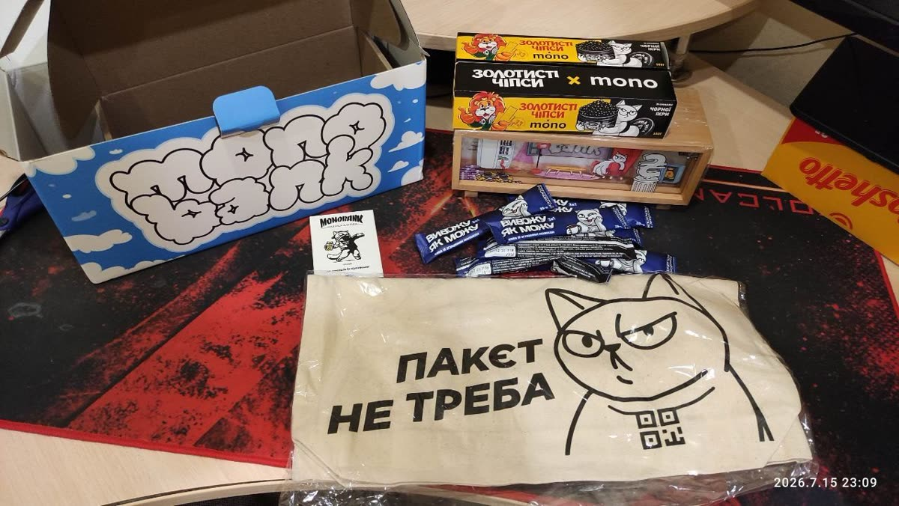
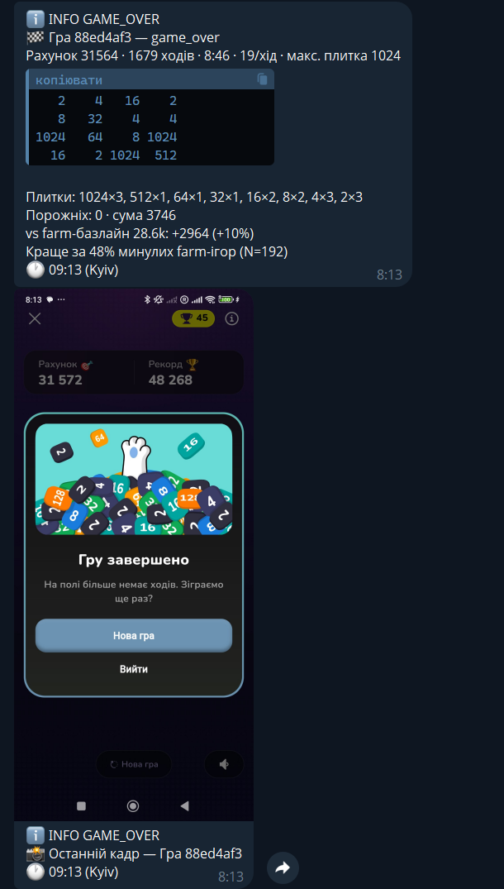

# monobank-2048 — бот, що грає у 2048 в застосунку monobank

Бот самостійно грає у міні-гру **2048** всередині Android-застосунку **monobank** —
на живому телефоні, без root і без модифікації застосунку. **39 місце** в
лідерборді гри у фіналі, 9-те в моменті — топ-50 отримували від monobank
секретний мерч.

Дивиться на екран, думає, свайпає і пише в базу кожен свій хід — щоб потім можна
було розібрати, чому він програв. Грає автономно: сам розблоковує телефон, сам
піднімається після помилок, сам звітує в Telegram.

---

## Зміст

**1. [Передмова](#1-передмова)**<br>
&nbsp;&nbsp;&nbsp;&nbsp;1.1. [Що це за гра і чим вона тут інша](#11-що-це-за-гра-і-чим-вона-тут-інша)<br>
&nbsp;&nbsp;&nbsp;&nbsp;1.2. [Результат](#12-результат)<br>
&nbsp;&nbsp;&nbsp;&nbsp;1.3. [З чим я прийшов у цю задачу](#13-з-чим-я-прийшов-у-цю-задачу)<br>
**2. [Стенд](#2-стенд)**<br>
**3. [Як це будувалося](#3-як-це-будувалося)**<br>
**4. [Еволюція пайплайну](#4-еволюція-пайплайну)**<br>
**5. [Гонка в лідерборді](#5-гонка-в-лідерборді)**<br>
**6. [Заміри і результати](#6-заміри-і-результати)**<br>
&nbsp;&nbsp;&nbsp;&nbsp;6.1. [Жива гра на телефоні](#61-жива-гра-на-телефоні)<br>
&nbsp;&nbsp;&nbsp;&nbsp;6.2. [Симуляція і тренування](#62-симуляція-і-тренування)<br>
&nbsp;&nbsp;&nbsp;&nbsp;6.3. [Пропускна здатність бектестів](#63-пропускна-здатність-бектестів)<br>
&nbsp;&nbsp;&nbsp;&nbsp;6.4. [Стеля: чому 58 тисяч не взято](#64-стеля-чому-58-тисяч-не-взято)<br>
&nbsp;&nbsp;&nbsp;&nbsp;6.5. [Спростування власних гіпотез](#65-спростування-власних-гіпотез)<br>
&nbsp;&nbsp;&nbsp;&nbsp;6.6. [Чим це закінчилось](#66-чим-це-закінчилось)<br>
**7. [Що бот робить сам](#7-що-бот-робить-сам)**<br>
&nbsp;&nbsp;&nbsp;&nbsp;7.1. [Відстеження помилок](#71-відстеження-помилок)<br>
&nbsp;&nbsp;&nbsp;&nbsp;7.2. [Введення пароля](#72-введення-пароля)<br>
&nbsp;&nbsp;&nbsp;&nbsp;7.3. [Звіти в Telegram](#73-звіти-в-telegram)<br>
**8. [Розпізнавання на телефоні](#8-розпізнавання-на-телефоні)**<br>
**9. [Оптимізації](#9-оптимізації)**<br>
&nbsp;&nbsp;&nbsp;&nbsp;9.1. [Латентність](#91-латентність)<br>
&nbsp;&nbsp;&nbsp;&nbsp;9.2. [Пошук](#92-пошук)<br>
&nbsp;&nbsp;&nbsp;&nbsp;9.3. [Байти і кеш](#93-байти-і-кеш)<br>
&nbsp;&nbsp;&nbsp;&nbsp;9.4. [Залізо](#94-залізо)<br>
**10. [Концепт і стратегія](#10-концепт-і-стратегія)**<br>
&nbsp;&nbsp;&nbsp;&nbsp;10.1. [Але це не той 2048, який ви знаєте](#101-але-це-не-той-2048-який-ви-знаєте)<br>
&nbsp;&nbsp;&nbsp;&nbsp;10.2. [Скільки резервуарів тримати](#102-скільки-резервуарів-тримати)<br>
&nbsp;&nbsp;&nbsp;&nbsp;10.3. [Де тримати 1024: перебрані схеми](#103-де-тримати-1024-перебрані-схеми)<br>
&nbsp;&nbsp;&nbsp;&nbsp;10.4. [Банкір: коли навмисно скласти 2048](#104-банкір-коли-навмисно-скласти-2048)<br>
&nbsp;&nbsp;&nbsp;&nbsp;10.5. [Як навчалась мережа і що не спрацювало](#105-як-навчалась-мережа-і-що-не-спрацювало)<br>
**11. [Структура](#11-структура)**<br>
**12. [Швидкий старт](#12-швидкий-старт)**<br>
**13. [Якість](#13-якість)**<br>
**14. [Безпека і приватність](#14-безпека-і-приватність)**<br>
**15. [Документація](#15-документація)**<br>
**16. [Ліцензія](#16-ліцензія)**<br>
**[P.S. Про перше місце](#ps-про-перше-місце)**

---

## 1. Передмова

### 1.1. Що це за гра і чим вона тут інша

**Класичний 2048:** на дошці 4×4 свайпом зсуваєш усі плитки; дві однакові, що
зіштовхнулись, зливаються в подвоєну. Мета — зібрати плитку 2048.

**У клоні monobank мета протилежна.** Тут **зібрати 2048 означає закінчити гру**:
плитка 2048 відкриває вікно «Ви зібрали 2048!» з єдиною кнопкою «Нова гра», а її
значення зараховується в рахунок. Тому максимальна плитка — **1024**, і гра
перетворюється з «дійди до 2048» на «нафармити якнайбільше маси, ні разу не
склавши 2048 випадково». Будь-який готовий 2048-бот тут грає на самогубство —
рушій довелося будувати з нуля. Детальніше — у [розділі 10](#10-концепт-і-стратегія).

<p align="center">
  
  <br>
  <em>Рисунок 1 — Бот грає сам: дошка складає злиття без жодного дотику до екрана.
  Телефон лежить на дуйчику, рахунок тікає 14 396 → 14 540</em>
</p>

### 1.2. Результат

**263 партії на реальному телефоні** — 318 364 записаних ходів, 35.9 години
чистої гри. Медіанний результат 34 034 очки, найкращий — **48 136**.

Телеметрія всіх 263 партій лежить у репозиторії
([`project/research/live-matches/`](project/research/live-matches/)) — числа нижче
беруться звідти, а не з тексту.

### 1.3. З чим я прийшов у цю задачу

Я займаюся автоматизацією на криптовалютних ринках, і значна частина цієї роботи —
**прогін бектестів на симуляціях**. Це виявилось ближче до нинішньої задачі, ніж
здається, бо дисципліна та сама: у тебе є стратегія, яку **не можна оцінити на
кількох прогонах**, є шум, який легко прийняти за сигнал, і є спокуса відібрати параметри за найкращим
результатом замість за розподілом. Хто на цьому вже горів, той рахує потужність
вибірки, а не радіє максимуму.

Тому [аудит потужності](#65-спростування-власних-гіпотез) у цьому проєкті — не
академічна вставка. Це рефлекс: коли на n=12 з'явився «+191 хід», я не повірив і
пішов міряти на n=100 — і ефект розсипався до +49 у межах шуму. Так само з
ринковими бектестами: результат на короткому вікні нічого не означає.

Друга половина — архітектурна. Цю задачу я бачив не як «написати бота для гри», а
як знайому форму: є зовнішня система, до якої немає API; є цикл «прочитати стан →
вирішити → подіяти»; є жорсткий дедлайн на оберт; і є вимога, щоб усе, що сталося,
лишалось у логах, бо інакше нічого не відладиш.

І третє — Android. В універі я писав застосунки під Android і взяв це ж за основу
дипломної роботи. Тому той бік стека — ADB, MediaProjection,
foreground-сервіси, accessibility, `FLAG_SECURE`, чому `uiautomator` бачить не
все — не був для мене дослідженням. Я не з'ясовував, як це працює; я знав, що
роблю, і питання було лише в тому, який із відомих варіантів тут швидший.

Це, як на мене, і є головний висновок проєкту, і він не про 2048. **Коли ти
знаєш, що треба зробити, а нейронка виступає в ролі реалізатора-помічника —
виходять справді сильні речі.** Модель дуже швидко пише те, що ти вмієш
специфікувати, і дуже впевнено пише те, що ти специфікувати не вмієш. Різниця
між цими двома випадками — і є вся різниця в результаті. У логу експериментів
є кілька записів, де я приймав числа від агента на віру, і вони згодом
розвалилися на більшій вибірці; є й записи, де моя інтуїція виявилась правильною
проти впевненого висновку моделі. Обидва класи задокументовані навмисно.

Тому порядок був очевидний з першого дня, і його не довелось перевигадувати:

1. **Спочатку MVP, який дограє одну партію до кінця.** Погано, повільно,
   але від початку до game-over. Поки цього немає, всі розмови про якість
   алгоритму — теорія.
2. **Потім заміри.** Не «здається, швидше», а числа по фазах.
3. **Потім покращення — і коду, і тестів разом.** Не по черзі. Кожна
   оптимізація, яку не можна перевірити тестом, — це майбутній баг, який ти
   знайдеш у три ночі на 1800-му ході живої партії.


## 2. Стенд

<p align="center">
  
  <br>
  <em>Рисунок 2 — Стенд: десктоп із трьома моніторами, MacBook Pro на коробці
  (праворуч) і телефон на дуйчику (край кадру, праворуч)</em>
</p>

| Машина | Роль |
|---|---|
| **Десктоп** — i7-9700K, 32 ГБ RAM, Windows | прод. Живий цикл: ADB, розпізнавання, рушій, свайпи. Тут же йшла оптимізація самого пайплайну. |
| **MacBook Pro M4 Pro**, 14 ядер | бектести й оптимізація симуляцій. Тут перевірялася кожна гіпотеза, перш ніж торкнутися прода. |
| **Робочий ноутбук** | паралельна робота. Спринт ішов не у вакуумі — робочі задачі нікуди не зникали, тому четверта машина просто жила своїм життям. |
| **Android-телефон** (POCO F3) | грав. |

MacBook Pro я взяв незадовго до цього саме під тестові прогони — і ось він
знадобився за призначенням з першого дня. Саме на ньому крутилися всі 105 млн
епізодів тренування і всі бектести, на яких ухвалювалися рішення.

Розділення не косметичне. Симуляція і жива гра конкурують за CPU, а жива гра має
жорсткий дедлайн на хід. Бектест на тій самій машині з'їдає бюджет пошуку і псує
саме ті числа, які ти міряєш — тобто ти оптимізуєш під артефакт власного
навантаження.

<p align="center">
  
  <br>
  <em>Рисунок 3 — Бектест на MacBook Pro: 18 процесів рушія, усі 14 ядер зайняті, <code>Idle 0.00%</code></em>
</p>

І тут та сама проблема, що з телефоном, тільки на іншій машині — **тротлінг**.
Дві причини, обидві дурні:

1. **На маці був увімкнений тихий режим** — виявилося, що він увімкнувся сам. Під
   такою постійною загрузкою це означає, що система тримає низькі частоти й
   обмежує обдув. Вимкнув явно.
2. **Забір повітря знизу.** MacBook бере холодне повітря з-під корпусу, а на
   столі він його там не має. Поставив ноутбук на коробку з-під цукру, щоб знизу
   був зазор — і тротлінг зник. Цю коробку видно на **Рисунку 2**: ноутбук
   стоїть саме на ній.

Разом це прибрало просідання частот на багатогодинних прогонах. Для бектестів це
критично: якщо машина тротлить **посеред**
прогону, ти отримуєш не «повільніше», а **зіпсовані заміри** — те, що ти
приписуєш конфігу, насправді є термодинамікою. Саме на цих граблях стояло правило
«один важкий прогін за раз».

<p align="center">
  
  <br>
  <em>Рисунок 4 — Телефон на дуйчику під час живої партії — «Рахунок 37 152» при
  «Рекорд 44 288» (та рекордна партія: 44 288 очок за 2 272 ходи)</em>
</p>

А ось найдурніша і найпотрібніша оптимізація всього проєкту.

Телефон грає без пауз годинами: екран горить, CPU рахує, USB заряджає. Він
гріється, ловить тротлінг — і хід, який зазвичай займає 340 мс, починає займати
секунду. Далі гірше: розпізнавання починає ловити кадри анімації, верифікація
ходу не збігається, прогін падає.

Нормальних засобів охолодження телефона під рукою не було — ні підставки з
кулером, ні термопрокладок. Тому взяв те, що було: **звичайний дуйчик**.

Але одразу вилізла друга проблема: від вібрації корпусу телефон **сповзав і
падав**. Вирішилось теж підручним — між телефоном і дуйчиком поклав **резинки для
купюр**, а під сам дуйчик рушник. Вийшов імпровізований сайлентблок: резинки
тримають телефон від сповзання й гасять високочастотну вібрацію, рушник забирає
низьку. На диво, працювало це дуже добре — за всі багатогодинні сесії телефон не
зрушив.

Після цього частоти не скидалися, і телефон тримав багатогодинні прогони
стабільно. Один нюанс побутовий: дуйчик шумить, тому **на ніч я переносив усю
конструкцію у ванну і зачиняв двері** — інакше спати під це неможливо.


## 3. Як це будувалося

Основним реалізатором був **Claude**. Це варто сказати прямо, бо це помітно
впливало і на швидкість, і на те, які рішення взагалі стало можливо перевірити.

Розподіл був такий:

- **Opus 4.8** — головний реалізатор: код рушія, живий цикл, тести, рефакторинги.
- **Fable 5** — продумування стратегій і алгоритмів. Не писати код, а відповідати
  на «чи це взагалі правильний напрямок», «що ми не бачимо», «який тут
  фальсифікований тест». Саме звідти прийшли кілька ключових розворотів —
  зокрема теза, що вузьке місце не у виживанні, а в **таймінгу кеш-ауту**, з
  якої виріс банкір рекорду.

Витрачено **три підписки по $200**, сумарно покладено **~2.5 тижневих ліміти**.

Дві деталі про сам інструмент, бо вони прямо впливали на результат. По-перше,
**системні промпти були модифіковані** під цю задачу — щоб модель тримала
дисципліну проєкту (не приймати число без заміру, не чіпати заморожені контракти,
писати тест разом зі зміною), а не загальні звички. По-друге, підключив
**оптимізатор токенів**, який за всі три дні зекономив близько **40% токенів** —
при такому обсязі роботи це різниця між «ліміт закінчився вночі» і «ліміт дотягнув
до кінця».

Пайплайн розробки жив у **п'яти паралельних сесіях** (кілька сесій на машину):
на десктопі йшла
оптимізація живого пайплайну, на MacBook — бектести й оптимізація симуляцій.

І окремо про режим, бо він теж частина результату. Лягав о першій ночі,
поставивши симуляції наніч; о сьомій ранку вставав і продовжував уже за
результатами того, що нарахувалося. **З сьомої ранку до першої ночі я відходив від
компʼютера двічі** — вмитись і поїсти. Запас продуктів був достатній, тому хоч із
цим проблем не було.

Виняток — **останній вечір**, у неділю: пішов відпочивати. І не з утоми, а тому що
робити вже було нічого. Мережі навчені, часу натренувати нові все одно не
залишалось, коефіцієнти підібрані — далі система просто **грала сама**. Це,
власне, і є найкраща перевірка автономності: коли фінальний етап проєкту не
потребує тебе.


## 4. Еволюція пайплайну

Пайплайн переписувався чотири рази, і кожен раз причина була одна — **латентність**.
Спочатку хід займав майже дві секунди, а гра приймає свайпи в темпі приблизно
5 на секунду. Тобто бот не грав, а спостерігав.

**Крок 1 — цілі кадри.** Найпростіше, що працює: `screencap`, PNG на комп'ютер,
розбираємо на місці. Один кадр — ~650 мс і ~442 КБ. Це MVP, і воно дограло першу
партію до кінця.

**Крок 2 — власний APK.** Замість тягнути картинку, телефон робить роботу сам:
знімає екран, бере **конкретні** точки (центри 16 клітинок), рахує колір пікселя,
співставляє з готовою мапою «колір → плитка» і надсилає **22 байти**. Кадр→пакет
став ~20–30 мс замість ~650. Це найбільший одиничний виграш у проєкті.

**Крок 3 — свайпи.** Спочатку кожен свайп ішов окремим викликом `adb` — а це
форк процесу на кожен хід. Перейшли на **постійний shell**: одне з'єднання
тримається відкритим, у нього просто пишуться команди. −83 мс на свайп.

**Крок 4 — мережа.** Наступним кроком мало бути замінити Wi-Fi на кабель. Не
вийшло: кабель не витягував одночасно заряджати і гнати дані, а грати без
заряджання телефон не міг. Рішення — **заряджати через блочок, а дані гнати по
локальній мережі**, поставивши телефон ближче до роутера. Не так елегантно, як
кабель, але швидко і стабільно.

І два сюрпризи, які з'їли час рівно там, де їх не чекаєш:

- **Локальний VPN додавав затримку.** У мене була піднята VPN-мережа, і трафік
  до телефона йшов через неї. Довелося пустити його **напряму між компом і
  телефоном** на роутері — інакше кожен ADB-виклик тягнув зайвий гак, а при
  бюджеті 340 мс на хід це помітно.
- **DHCP переназначив телефону IP посеред прогону.** Тобто бот просто втратив
  пристрій на живій партії. Лікується не кодом: зайшов у роутер і **прописав
  телефону статичну адресу**, щоб більше не повторювалось. Один із тих випадків,
  коли проблема виглядає як баг у твоєму софті, а лежить на два рівні нижче.

Разом ці чотири кроки — і є той шлях від майже двох секунд на хід до 340 мс.
Скільки саме зрізала кожна фаза, з провенансом замірів, — у
[4.1 Латентність](#91-латентність).

---


## 5. Гонка в лідерборді

Найцікавіше в цьому змаганні — що лідерборд був **видимою кривою еволюції
алгоритмів**. По ньому читалося, хто на якому етапі:

| Коли | Рекорд топу |
|---|---|
| перші дні | ~34 тисячі |
| другий день | 48 тисяч |
| третій день | почали виходити 50+ |

І рухалося це не днями, а годинами. **Різниця у 5 годин відчувалася сильно.**
Якщо в якийсь момент дня в топі було кілька результатів 45+, то через 12 годин
**весь** топ тримав 45+. Тобто ти конкурував не з людьми, а з темпом, з яким усі
одночасно доходили до тих самих ідей.

І тут вилізла деталь, якої я не передбачив: **щоб подивитися лідерборд, треба
вийти з гри.** А телефон грав **24/7** — вийти означало обірвати партію, яка вже
йшла півтори тисячі ходів. Тому весь турнір я дивився на топ **чужими очима**:
просив батьків заходити в застосунок і казати, які там зараз результати. Виглядає
смішно, але це рівно та сама проблема, що й у решті проєкту — **спостереження
коштує**. Саме тому бот сам звітує в Telegram: єдиний спосіб знати, що
відбувається, не втручаючись у те, що відбувається.

Мій фінал — **39 місце**. У моменті тримав **9-те**.

І ось де видно, куди я вклав основне зусилля. Подивіться на **час партії** в
колонці поруч із рахунком:

<p align="center">
  
  <br>
  <em>Рисунок 5 — Той самий рахунок, різний час: у мене 14:33, у решти топу 40+
  хвилин. Мій рядок — 19-й; імена й аватарки інших гравців розмиті</em>
</p>

У решти топу партія тривала **40 хвилин і більше** — до 137 хвилин. У мене той
самий результат займав **14:33**. Тобто я грав ту саму гру **в три-дев'ять разів
швидше за хід**, а отже встигав зіграти в кілька разів більше партій за ту саму
добу. А коли твій результат — це максимум із багатьох спроб, кількість спроб і є
стратегія.

Саме тому я пішов не в «розумніший алгоритм», а **в оптимізацію пайплайну** — туди,
куди, судячи з часу партій, майже ніхто не пішов. Я міг собі це дозволити, бо
Android-стек і так знав. І це помітили збоку: друзі та одногрупники писали в
Telegram, що бачать у топі партію з часом, який не збігається з людським. Було
приємно.


І ще одне, що я знав із самого початку: **я бився не з ботами, а з людьми — і це
було видно з цифр.** Тут одразу скажу, що це **оцінка, а не замір**: як людина, що
писала цей алгоритм і бачила розподіл зблизька, я не вірю, що руками можна взяти
більше ніж ~36 тисяч — далі це вже питання витривалості, а не вміння. Тому кожен результат у топі вище цієї межі означав, що
там теж стоїть автоматизація.

Для мене це й було найцінніше в результаті: у **22 роки**, **маючи тільки локальні
потужності** для навчання мережі — один ноутбук, жодного кластера й жодних
орендованих GPU — **змагатися з програмістами з усієї України** і триматися в
топі. Не перше місце, але й далеко не «спробував і не вийшло».

Різниця між 9-м місцем у моменті і 39-м у фіналі — це одне рішення. Ввечері я пішов
**all-in**: замість того щоб фармити надійні 40+ (44 партії з 263 брали понад 40
тисяч), націлився на 50+ і виставив агресивнішу гру. Не вийшло.

Заднім числом це той самий висновок, який до того тричі підтвердився замірами і
записаний у логу експериментів: **жорсткі агресивні override-и шкодять, м'які
підказки допомагають.** Я знав це про рушій — і все одно зробив на рівні
стратегії турніру. Такий собі найдорожчий підтверджувальний експеримент у
проєкті.


## 6. Заміри і результати

### 6.1. Жива гра на телефоні

Усі числа — з [`project/research/live-matches/`](project/research/live-matches/),
витягу з телеметрії кожної партії:

| Метрика | Значення |
|---|---|
| Зіграно партій | **263** (192 дограли до фінального рахунку) |
| Записано ходів | **318 364** · спавнів **319 319** |
| Часу гри | **35.9 години** |
| Медіанний рахунок | **34 034** (середнє 29 123 — його тягнуть вниз обірвані партії) |
| Медіанна партія | **1 853 ходи**, ≈ 10 хвилин |
| Партій ≥ 40 000 / ≥ 45 000 | **44** / **2** |
| **Найкраща партія** | **48 136** очок, 2 432 ходи, максимальна плитка 1024 |
| Рушій у живій грі | ~57 мс/хід, темп 2.55 ходу/с |

### 6.2. Симуляція і тренування

| Метрика | Значення |
|---|---|
| Фінальний вимір стелі | **8 220 партій** — медіана 38 928, **максимум 51 128**, p99.9 = 51 092, ≥ 52 000 — **0 партій** |
| Максимум не рухався | від n = 2 880 до n = 8 220 — ні на одне очко |
| Тренування мережі | **≈ 105.7 млн епізодів**, ≈ 11 годин рахунку (нижня межа; реалістично 140–150 млн) |
| Пік швидкості тренування | **4 037 епізодів/с** на 14 воркерах |
| Модель | 8 × 6-tuple, **14 172 488 вагів ≈ 57 МБ**, TD(0) + Hogwild |
| Backward curriculum | банк **24 000** planted-дошок, щоб мережа взагалі бачила щільний late-game |

Симулятор звірений із реальністю на тих самих 263 живих партіях: `P(4)`, умови
завершення, кеш-аут — усе збігається. Єдине розходження **завищує** рахунок
приблизно на 2%, тобто справжня стеля навіть трохи нижча.

### 6.3. Пропускна здатність бектестів

| Машина | Воркерів | мс/хід (1 потік) | ходів/с | партій/год |
|---|---|---|---|---|
| MacBook Pro M4 Pro | 4 | **54.9** | 60.6 | **124** |
| Десктоп i7-9700K | 6 | 75.6 | 65.3 | 150 |
| MacBook, `cprob=1e-5` | 13 | 422.6 | 28.9 | 59 |

На один потік M4 Pro швидший приблизно в 1.4× — власне тому бектести жили на
ньому. Третій рядок показує, чого коштував глибший поріг відсікання: хід дорожчий
**у 7.7×**, а партій за годину — **у 2.1× менше** за той самий результат (тому його
й відкинули).

### 6.4. Стеля: чому 58 тисяч не взято

Рекорд топу — **58 тисяч**, і його **не побито**. Але це не «не вийшло», а
зміряний і закритий результат. Ось чесна драбина, від того, що бот реально
робить, до того, що взагалі можливо:

| Сценарій | Очок | Що це |
|---|---|---|
| **Стеля цього бота** на власному розподілі | **51 128** | максимум із 8 220 партій, далі не рухається |
| Бот із «подарованої» щільної дошки | **63 576** | максимум, коли чемпіону вручну дали дошку 3×1024+4×512+2×256 (середнє 55 846, 49% партій ≥ 55k) |
| Оцінка межі для **будь-якої** політики на 4×4 | ≈ **58–62 тис.** | скільки взагалі вміщується на цій дошці — не про конкретний рушій |
| Межа за легальністю | 106 496 | 8×1024 + 8×512 у шаховому порядку — доведено оптимальність, але таку дошку не побудувати |

Тобто цікава цифра — не 106 тисяч, а **63 576**: рекордна дошка **банкується**,
якщо вона в тебе вже є. Проблема в тому, що вона **не лежить на природному шляху
гри** — щоб її втримати, треба нести зайву 256-ку в затор, і це вбиває. Парний
замір: зберігати підтримку замість спалити дає **ΔEV = −1173**, а смертність
росте з 0.94 до 0.99. Тобто спалювати — **чесно оптимально**, і 55–63k є лише
у виживальницькій вибірці.

58 тисяч — це ≈ 3 135 ходів в одній партії, тобто **+29%** до найкращої реальної
партії бота (2 432 ходи). Причина не в силі оцінної функції, а в геометрії дошки 4×4: при
ризик-зміщенні політики і виживання, і щільність падають **одночасно** — це не
компроміс, це строге погіршення. Єдиний шлях, що залишився, — не рушій, а
кількість спроб: виловити рідку (~1e-4) сприятливу дошку.

### 6.5. Спростування власних гіпотез

- **Табу майже не в'яже.** Здавалося, що 1024-плитки душать мобільність.
  Зміряно на ~18 860 ходах: табу заблокувало **5 ходів = 0.027%**, а ситуація
  «немає безпечного напрямку» не траплялася **жодного разу**.
- **П'ятий резервуар — смертний вирок.** `P(смерть ≤ 100 ходів | k=5)` =
  **93–100%** на всіх рівнях заповненості. Парний зріз n = 664: k=3 → 49%
  смертності, +1 резервуар → 93%, +2 → 100%. Жодна з 36 розстановок не рятує.
  Сирі дані (8 592 рядки) лежать у репозиторії — результат перераховується.
- **«Глибина 6» насправді 4.6.** При 8 порожніх клітинках середня глибина листка
  4.60, листя на глибині 6 — **нуль**.
- **Щільність — не важіль.** Фінальні дошки бота вже на **93–99%** оптимальні
  для набраної маси. Довжина партії і щільність — одна змінна, не дві.
- **Чотири ранні висновки «беремо/викидаємо» були шумом.** При σ ≈ 5 000
  мінімально помітний ефект на n = 12 — це 5 715 очок. A/A-симуляція (200 тис.
  повторів): «−27k на 6 партіях» виникає з чистого шуму в **12%** випадків.
  Ефект, оцінений як +191 хід на n = 12, на n = 100 виявився **+49 ходів,
  t = 1.79** — у межах шуму. Найгірший спосіб відбору — «максимум із N партій»:
  різниця максимумів у 3 588 очок виникає з чистого шуму в **42%** випадків. І
  дешевшає повільно: мінімально помітний ефект — 8 083 очки на n = 6, 5 715 на
  n = 12, 2 800 на n = 50 і лише 1 400 на n = 200. Міряти хвіст прямо надто
  дорого — на `P(≥48k)` треба ~**13 000** партій, — тому варіанти відбираються за
  оцінкою розподілу, а не за середнім і ніколи за максимумом.
- **n=2 збрехало.** Гіпотеза таймінгу кеш-ауту на двох партіях дала +1 772 і
  +2 684. На n = 50 вона ж дала медіану **−5 264**. Відтоді «смоук на двох
  сідах» не вважається результатом.

Розбір: [`docs/tail-analysis.md`](docs/tail-analysis.md) ·
[`docs/experiment-log.md`](docs/experiment-log.md) (43 записи, найновіші зверху) ·
[`docs/training-and-runs-census.md`](docs/training-and-runs-census.md) (що саме тренували і скільки).

### 6.6. Чим це закінчилось

<p align="center">
  
  <br>
  <em>Рисунок 6 — Мерч від monobank за результат у лідерборді</em>
</p>

Якщо коротко про підсумок — **було круто перевірити це на собі.** Не в сенсі
«виграв», бо 39 місце це не перемога, а в сенсі: взяти задачу, де немає API, де
цільова функція виявляється перевернутою, де латентність вирішує більше за
алгоритм — і довести весь шлях до живого телефона, який грає сам ночами й сам
звітує, коли щось ламається.

І окремо цінне те, що впиралися ми в кінці не в код. Стеля рушія зміряна двома
незалежними способами, десять напрямків закриті з мотивуванням, а те, що
лишилось, — це вже не «напиши краще», а кількість спроб. Дійти до точки, де ти
можеш **довести**, що далі виграшу немає, виявилось цікавіше, ніж просто підняти
число.

Ще один особистий підсумок — **Go**. Розподіл вийшов природний: **MVP на Python**
(швидко написати й перевірити, що ідея взагалі працює), а коли стало ясно, що
впираємось у швидкість — **оптимізація вже на Go**.

Тут можна було взяти **Rust**: у нього об'єктивно кращі інструменти для
паралелізації і суворіші гарантії. Я обрав Go свідомо — раніше з ним усерйоз не
працював і хотів подивитися, як воно всередині. І він виявився ідеальною
пісочницею саме під таку роботу: бітборди, precomputed таблиці, lock-free
структури без вказівників (щоб їх не бачив GC), PGO, збірка під конкретний набір
інструкцій, і головне — постійна перевірка чексумом, що ускорення не змінило
жодного рішення. Це той рівень, де ти працюєш не з алгоритмом, а з тим, як
машина насправді виконує код.

Найкраще, наскільки глибоко це зайшло, показує один баг. У певний момент
профілювання показало, що **синхронний запис логів сам став вузьким місцем**:
structlog у проді взагалі не був сконфігурований, тому працював дефолт — рендер у
консоль синхронним логером **без фільтрації за рівнем**. Тобто кожен
`debug`-рядок на кожен хід повністю рендерився і писався **на критичному шляху**,
поки бот мав встигнути зробити хід. Виправлення: фільтр за рівнем **першим** у
ланцюжку (тоді закритий `debug` відпадає за ~4 мкс, ще до форматування часу), а
серіалізація в JSON і запис у файл — на фоновий потік через `QueueListener`, з
дренажем черги на виході, щоб FATAL не втратив жодного рядка.

Коли твоє вузьке місце — це `print`, а не алгоритм, це означає, що з алгоритмом
ти вже зробив те, що міг. Такі задачі й прокачують навички оптимізації найкраще.

**Що далі.** Під такі задачі я вже взяв **Mac Mini** — ARM тут виявився помітно
сильнішим, і це не відчуття, а цифра з цього ж проєкту: на один потік M4 Pro
рахував хід за **54.9 мс** проти **75.6 мс** на i7-9700K, тобто ~1.4× швидше. Для
бектестів, де ти впираєшся в мільйони ходів, така різниця вирішує, скільки
гіпотез ти встигаєш перевірити за ніч.

А далі — **сервери Google Cloud** (там 300 подарункових доларів на старт).
Бектести ідеально ріжуться на паралельні шарди,
і саме цей проєкт наочно показав, скільки коштує впирати симуляції в одну машину,
яка ще й тротлить посеред прогону. **Горизонтальне масштабування ніхто не
відміняв** — на цьому етапі воно дає більше, ніж будь-яка наступна оптимізація
рушія.


## 7. Що бот робить сам

Прогін на кілька годин не переживе жодна система, яка потребує людини на кожен
збій. Тому автономність тут — не фіча, а умова, щоб зібрати 263 партії.

Конкретно бот сам: **розбирається з помилками** (і відрізняє відновлювані від
тих, де треба стати), **вводить пароль** до застосунку після блокування,
**підхоплює незакінчену партію** замість того щоб стерти її новою, перезапускає
гру після game over і **звітує про все**.

Останнє — не деталь, а те, що робить решту можливою: кожна така подія пише себе
**в три канали одночасно** — у Telegram (щоб бачив я), у потік алертів (щоб
бачила Claude-сесія й могла втрутитися) і **у файли логів** (щоб потім можна було
розібрати постфактум те, чого ніхто не бачив у момент). Плюс уся гра — в SQLite,
хід за ходом.

### 7.1. Відстеження помилок

Помилки розділені на **два класи**, і це головне рішення:

- **ERROR** — відновлюване: не розпізнався кадр, хід не підтвердився, застряг
  рушій. Бот сам ретраїть, перезапускає гру або перепідключається.
- **FATAL** — зупинка: екран, який бот не має права торкатися (наприклад
  банківський інтерфейс замість гри). Тут краще стати і чекати людину, ніж
  тапати навмання у банківському застосунку.

Навколо цього:

- `logs/alerts.jsonl` — append-only, `flush()` + `fsync()` на кожен рядок, щоб
  запис вижив навіть при жорсткому вбивстві процесу.
- **Інцидент-бандли** — на кожній помилці зберігається все для розбору
  постфактум: кадр до і після, дамп UI, очікувана дошка проти розпізнаної,
  останні N ходів і traceback.
- **Heartbeat-файл** — якщо цикл завис, файл перестає оновлюватись, і це видно
  зовні. Сам процес про своє зависання повідомити не може.
- **Бюджет рестартів** — не більше 6 на годину, кулдаун 60 с, pid-лок проти двох
  паралельних раннерів. Без цього «саморемонт» стає циклом падінь.
- **Таймаут на кожен блокуючий ADB-виклик**, а watchdog рушія відрізняє *смерть*
  процесу від *затримки* — це різні реакції.

Окремо: при старті бот **не стирає незакінчену партію**, а підхоплює її з дошки.
Перезапуск не коштує гри.

І ще один шар, зовнішній. Код писався в тому числі **під інструмент Monitor у
Claude Code**: алерти йдуть у потік, який читає жива Claude-сесія. Тому якщо
щось ламалося так, що бот сам не піднявся, сесія бачила сповіщення **одразу** і
далі або перезапускала прогін, або підключалася по ADB, знімала скріншоти й
розбиралася на місці — тобто робила те, що інакше робив би я, розбуджений о
третій ночі.

Практичний висновок з цього дуже простий: **я спокійно спав**. Не тому, що
система ідеальна, а тому що знав — на будь-яку помилку є кому відреагувати, і
прогони справді йтимуть усю ніч. Саме це й дало гру **24/7**, а не «поки я
дивлюсь».

### 7.2. Введення пароля

Банківський застосунок сам блокується на холодному старті й вимагає PIN, а бот
має грати годинами без людини. Тому бот **вводить пароль до акаунта monobank
сам** — інакше кожен холодний старт означав би кінець прогону.

І тут варто сказати прямо, чому в цьому розділі така параноя. Бот грав у
застосунку, **де лежить уся моя стипендія**. Не в піщанці, не на тестовому
акаунті — на живому банківському акаунті з реальними грошима. Пароль я одразу
виніс у змінну середовища, і навколо нього побудований жорсткий контракт:

Повний контракт навколо пароля — у [Безпеці](#14-безпека-і-приватність).

Екран авторизації гасить захоплення (`FLAG_SECURE`), тому визначається трьома
незалежними сенсорами: нульовий розмір `screencap`, лічильник чорних кадрів у
відеопотоці, і `uiautomator dump` — який під `FLAG_SECURE` ще працює. На екрані
авторизації бот не робить **жодного** тапу, поки не впевнений, що це саме він.

### 7.3. Звіти в Telegram

<p align="center">
  
  <br>
  <em>Рисунок 7 — Звіт бота в Telegram після завершення партії — з дошкою, гістограмою плиток і останнім кадром</em>
</p>

Кожна партія і кожна помилка їдуть у Telegram-бот. Звіт самодостатній — по ньому
видно, що сталося, не заходячи на машину: рахунок, кількість ходів, час, мс на
хід, максимальна плитка, дошка у текстовому вигляді (з кнопкою «копіювати»),
гістограма плиток, скільки порожніх і сумарна маса, порівняння з farm-базлайном
(`+2964`, `+10%`) і місце серед минулих партій (`краще за 48% з 192`). Знизу —
останній кадр з телефона.

Реалізація свідомо нудна, бо це шар, який мусить працювати, коли все інше вже
зламалось: тільки stdlib (`urllib`), токен замаскований у `repr`, офлайн-outbox
із `fsync`, журнал дедуплікації проти спаму одним інцидентом, окремий
процес-спостерігач (щоб було кому звітувати, коли впаде сам раннер) і allowlist
по `chat_id`.


## 8. Розпізнавання на телефоні

Найдорожчою частиною циклу було не думання, а **дивитись**: `screencap` по Wi-Fi
віддає кадр за ~650 мс.

Спершу ми спробували обійтися без пікселів узагалі: Android віддає дерево екрана,
і здавалося, що плитки можна просто прочитати як текст. Дамп посеред активної гри —
**5919 байт**, у яких є лише контейнери й один обфускований кастомний в'ю, і
**жодного вузла-плитки**. Дошка малюється пікселями всередині власного полотна, у
дереві доступності її просто немає — тому шлях через XML закритий назавжди, і
розпізнавання дошки може бути тільки колірним. (Під анімації той самий дамп ще й
часто відмовляє: «не можу дочекатися спокою UI».)

Рішення — власний Android-застосунок, який забирає частину роботи на себе.
Телефон **сам семплить 16 центрів клітинок** через MediaProjection (без root),
співставляє колір із каліброваною палітрою і віддає хосту готову дошку —
**22 байти** замість ~442 КБ PNG або 10 МБ сирого кадру. Вийшло **~20–30 мс** на
шлях «кадр → пакет» і ~1 мс роботи на стороні хоста.

Формат пакета (big-endian, фіксовані 22 байти):

| offset | size | поле |
|---|---|---|
| 0 | 2 | magic `B2` — щоб хост міг ресинхронізуватись |
| 2 | 1 | версія |
| 3 | 1 | флаги |
| 4 | 2 | seq — лічильник семплів (свіжість / дедуп) |
| 6 | **8** | **дошка: 16 нібблів**, по 4 біти на клітинку |
| 14 | 2 | бітмаска «клітинка розпізнана невпевнено» |
| 16 | 4 | час пристрою, мс — для заміру латентності |
| 20 | 2 | CRC-16/CCITT над байтами 0..19 |

Ніббл на клітинку — це точно, без втрат: експонента ніколи не виходить за 0..15,
а 15 — це вже 32768, тобто далеко за межею гри.
А фіксований розмір із magic на початку і CRC у кінці дає головне для з'єднання,
яке живе годинами — потік можна перечитати після збою, замість довіряти зіпсованим
байтам.

Дві деталі:

- **Kotlin — це порт з Python.** Хостова реалізація семплера існує як референс, і
  обидві поділяють ті самі golden-вектори як контракт відповідності. Тому
  «телефон і комп'ютер бачать дошку однаково» — це тест, а не надія.

**І окрема причина, чому живий шлях прив'язаний саме до застосунка.** Був
дешевший варіант — брати кадри з відеопотоку телефона, але це стиснення з
втратами. Коли маскот-кіт застосунка перекриває верх дошки під час анімації,
піксельний збіг дошки просідає до **~81%**, а кнопка «Нова гра» внизу присутня
завжди — детектор бачить «дошка 81% + кнопка нової гри», не може впевнено сказати,
що на екрані, і зупиняє прогін як фатальний. Гра при цьому жива. Так і помер один
живий прогін — на **22-му ході**. Кадри з APK і сирі скріншоти втрат не мають: на
цьому шляху кампанія на **8342 ходи** пройшла без жодного такого спрацювання.

Інжекція свайпів через APK теж реалізована й покрита тестами, але **навмисно не
підключена**: свайпи й далі йдуть через shell, бо банківський застосунок може
перелічувати активні accessibility-сервіси.


## 9. Оптимізації

Спільне правило для всього розділу: кожна зміна або **біт-у-біт не змінює
рішення рушія**, або її ефект зміряний окремо. «Здається, швидше» тут не
вважалося результатом.

### 9.1. Латентність

**Хід: 1.9 с → 340 мс** — це шлях **від першого MVP до фінального стану**, а не
виграш від однієї зміни. На старті бот витрачав майже дві секунди на хід, тобто
не грав, а спостерігав: гра приймає свайпи в темпі близько 5 на секунду. Нижче —
той самий шлях, розкладений по фазах: «було» — це MVP, «стало» — фінал.

| Фаза | Було | Стало |
|---|---|---|
| захоплення кадру | ~650 мс (`screencap` по Wi-Fi) | **20–30 мс** — [власний APK](#8-розпізнавання-на-телефоні) |
| свайп | 248 мс | **109 мс** — постійний shell замість форку на кожен свайп (−83 мс) + коротший жест |
| думання | 25–75 мс | **≈ 0** — спекулятивний prefetch |
| очікування анімації | 600–1300 мс | **53–156 мс** — верифікація по передбаченій дошці замість «чекати стабільний кадр» |

> Провенанс: колонка «було» — з окремих замірів на старті; «стало» зведене з двох
> живих сесій (одна на 1731 ході дала 344 мс/хід зі свайпом 141 і settle 156,
> пізніша — ~330 мс/хід зі свайпом 109 і settle 53), тому діапазони, а не одне
> число. Точні перцентилі по фазах дає `bot2048 db latency` — він читає
> `moves.eval_details_json.timing` і рахує p50/p90/p95/max.

**Вузьке місце — анімація, і обійти її неможливо.** Гра малює переїзд плиток **≈115 мс**
(зміряно покадрово), і поки анімація не завершилась, наступний свайп або не
зареєструється, або зареєструється в недомальовану дошку. Тобто це не мій код
гальмує — це **фізична підлога**, задана застосунком.

Але з цього випливає інше: **під час анімації процесор вільний.** І я знаю
рівно дві речі — дошку після свайпу і те, що зараз народиться одна плитка 2 або 4
на одній із порожніх клітинок. Тобто множина можливих наступних станів **скінченна
й відома заздалегідь**.

Звідси **кеш рішень наперед**: поки грає анімація, рушій перебирає всі ці стани й
для кожного вже дораховує найкращий хід. Коли спавн реально відбувається,
відповідь **уже лежить готова** — залишається її дістати. У таблиці вище це та
сама «думання: 25–75 мс → ≈ 0».

І ще один ефект, який спочатку здається протиінтуїтивним: **чим менше плиток на
дошці, тим дешевше рахувати.** Причина в тому, що на багатьох порожніх клітинках
імовірність розмазується між багатьма варіантами спавну, кожна гілка швидко стає
малоймовірною — і відсікання за накопиченою ймовірністю ріже її рано (при `1e-4`
відсікається **80.6% листя**). А ось у щільному ендгеймі варіантів спавну мало,
кожен важить багато, дерево лишається живим глибше — і хід коштує в рази дорожче.
Саме тому бюджет пошуку зроблений драбиною: у ранній грі він мінімальний, а до
ендгейму піднімається до ~9 с.

Разом це дає головне: **пошук на глибині 4 встигає завершитись швидше, ніж
триває анімація** — 25 мс проти 115. Думання перестає бути фазою ходу.

Prefetch при цьому **сам себе вимикає**, коли не потрібен: тримає EMA проміжків
між викликами і відключається, якщо пауза коротша за вартість пошуку. У симуляції
виклики йдуть впритул — там він лише марно палив би IPC; у живій грі пауза
~200 мс, і він працює. Рішення від prefetch не змінюються — це чистий виграш
латентності, не якості.

### 9.2. Пошук

**2.20× швидше, рішення біт-у-біт ті самі.** Чотири зміни: leaf-value cache,
PGO, `GOAMD64=v3`, 8 воркерів замість 6.

Контроль коректності — чексум рішень на 150 ендгейм-дошках:
`1c04de39f1130696` **однаковий на кожному кроці**. Вивільнений бюджет ≈ **+1
рівень горизонту** пошуку за той самий час.

Глибші налаштування пробували й закрили замірами, а не інтуїцією: і глибина 7, і
`cprob=1e-5` виявились гіршими — обидва в таблиці
[§10.5](#105-як-навчалась-мережа-і-що-не-спрацювало).

### 9.3. Байти і кеш

**Дошка — це один `uint64`.** 16 клітинок × 4 біти: замість масиву — одне
машинне слово, яке ходить у регістрі. Хід рахується не по клітинках, а таблицями,
попередньо порахованими для **всіх 65 536** варіантів 16-бітного рядка.

**У базі дошка — 16 hex-символів.** Мільйони рядків телеметрії, і кожен несе
знімок дошки до і після ходу; компактне кодування — те, що робить повний replay
кожної партії практичним, а не теоретичним.

**Рахунок — точне ціле в `float64`**: значення завжди в межах, де `float64`
представляє цілі точно, тому арифметика рахунку не накопичує помилку.

**Головне вузьке місце — не арифметика, а пам'ять.** Оцінка одного листа — це
**64 випадкові звертання** в таблицю ваг на **~57 МБ**. Вона не влазить у кеш
процесора, тому лист **обмежений латентністю DRAM**, а не обчисленнями. З цього
два наслідки:

- **Leaf-value cache: 2²² слотів × 16 Б = 64 МБ.** Оскільки лист — чиста функція
  дошки при фіксованих вагах, кешоване значення **ніколи не потребує
  інвалідації**: воно переживає і рівні пошуку, і реальні ходи. Кеш
  direct-mapped і lock-free (XOR-схема Хаятта: читач, що застав слот під час
  запису, побачить неузгоджену пару «ключ↔значення» і прочитає це як промах —
  ніколи як хибне значення). Структура без вказівників, тому GC її не бачить.
  **Hit-rate 60.9%** — саме тому це виявилось найбільшим важелем: не «порахувати
  лист швидше», а **не рахувати його вдруге**.
- **Розділення обчислення індексів і читання ваг.** Спершу рахуються всі 64
  індекси (таблиця не чіпається), потім ідуть 64 незалежні читання. Оскільки
  адреси вже відомі, звертання до пам'яті **перекриваються** замість чекати одне
  одного. Порядок додавання збережений байт-у-байт, тому результат ідентичний.
  Виграш архітектурно-залежний: на x86 працює, на Apple M4 — регресія 8–15%
  (широке out-of-order ядро й так приховує ці читання), тому прапорець і дефолт OFF.

Транспозиційна таблиця — 2¹⁸ записів, 2-way probe, і **не очищується** між
ходами: замість дорогого обнулення в записі лежить номер «епохи», за яким
застарілі елементи розпізнаються на льоту.

### 9.4. Залізо

- **PGO + `GOAMD64=v3`** — збірка під конкретний CPU. Перевірено, що на amd64 це
  не змінює жодного рішення (Go не фьюзить FMA на цій архітектурі).
- **8 воркерів замість 6.** Формула «залишити 2 ядра системі» втрачала
  throughput: лист обмежений латентністю пам'яті, тому зайняти всі ядра вигідніше.
  На тренуванні виявилось дзеркальне: **12 воркерів були повільніші за 8**, коли
  на машині паралельно щось крутилось — та сама CPU-contention, через яку діяло
  правило «один важкий прогін за раз».
- **Тестова суїта: 55.8 с → 35 с.** Сюїту ганяли десятки разів на день. Заодно
  з'ясувалося, що `-n8` **повільніше** за `-n2`: вісім паралельних
  ffmpeg-пайплайнів били один одного. Тести, які тримають відео, тепер прибиті до
  одного воркера.


## 10. Концепт і стратегія

```
┌──────────┐   кадр    ┌────────┐  Board  ┌─────────┐  напрямок  ┌──────────┐
│  телефон │──────────>│ vision │────────>│  рушій  │───────────>│  свайп   │
│ (ADB/APK)│  22 байти │ дошка  │         │ Go+TD   │            │ humanizer│
└──────────┘           └────────┘         └─────────┘            └──────────┘
      ▲                                        │                       │
      └────────────────────────────────────────┴───── SQLite ──────────┘
                     верифікація ходу на екрані     (кожен хід і спавн)
```

Замкнений цикл на кожен хід: захопити екран → розпізнати 16 клітинок →
порахувати хід пошуком по дереву → свайпнути з людяним джитером → записати.
Приблизно 340 мс на повний оберт.

### 10.1. Але це не той 2048, який ви знаєте

У клоні monobank **зібрати 2048 означає закінчити гру**. Плитка 2048 відкриває
вікно «Ви зібрали 2048!» з єдиною кнопкою «Нова гра», а її значення
зараховується в рахунок як кеш-аут.

- **Максимальна плитка — 1024.** Мета не «дійти до 2048», а «нафармити максимум
  маси, ні разу не склавши 2048 випадково».
- З'являється **табу на напрямок**: якщо хід складе дві 1024 разом — його не
  можна робити. Точний закон вивели повним перебором усіх 11⁴ = 14 641 варіантів
  рядка — **нуль контрприкладів**: напрямок збирає 2048 тоді й лише тоді, коли
  дві 1024 стоять в одній лінії, а між ними лише порожні клітинки.
- **Будь-який готовий 2048-бот тут непридатний.** Усі вони оптимізують рух до
  2048 — тобто грають на самогубство. Рушій довелося будувати з нуля.

І це не було припущенням — **готові реалізації ми перебрали.** Переглянули відомі
2048-рушії й дослідницькі роботи (табличний expectimax на бітбордах, n-tuple-мережі
з TD-навчанням, кілька відкритих проєктів із готовими вагами) і кожен оцінили за
одним критерієм: **чи витягне він 45+ тисяч за правилами цього клону.** Не витягнув
**жоден** — усі вони оптимізують шлях до 2048, тобто рівно те, що тут убиває партію,
і жоден не знає про табу на напрямок. Тому забрали з них найкраще — бітборди,
precomputed таблиці рядків, відсікання за накопиченою ймовірністю, саму ідею
n-tuple-оцінки — і пішли будувати й тестувати своє.

**Правила ніде не описані — їх довелося виводити, а потім перевіряти самими ж
даними.** Формула рахунку вийшла аналітично: це сума `(r−1)·2^r` по плитках, мінус
4 за кожну четвірку, що народилася й досі сидить усередині цих плиток. Перевірка
вийшла самозамкненою: з одного живого екрана («Рахунок 25264» і видима дошка)
формула дає 138 четвірок на 1421 спавн, тобто `P(4)` = **9.71%**. Незалежно, по
телеметрії **1832** спавнів, зміряно `P(4)` = **9.77%** — два не пов'язані виміри
збіглися з точністю **0.06 п.п.** Позиція спавну при цьому рівномірна по порожніх
клітинах (χ² = 8.5, 15 ступенів свободи, **p ≈ 0.90**): перекіс у бік кутів на
сирій теплокарті — артефакт того, де бот лишає порожнє місце, а не зсув
генератора.

Порівняння варіантів: [`docs/research/engine-adoption-research.md`](docs/research/engine-adoption-research.md).
Правила клону встановлені емпірично й перевірені: [`docs/rules-research.md`](docs/rules-research.md).

### 10.2. Скільки резервуарів тримати

**`k` — це кількість плиток 1024 на
дошці.** Оскільки 1024 більше ніколи не зіллється, кожна така плитка — **мертвий
баласт**: гра фактично йде не на 16 клітинках, а на `16 − k`. Я називаю їх
«резервуарами», бо вони накопичують масу, з якої вже нічого не витягнеш.

**Резервуари з'являються майже за годинником:**

`k=1 → хід 491 · k=2 → 957 · k=3 → 1420 · k=4 → 1895`

Крок ≈466 ходів — це рівно `1024 / 2.2`, бо маса надходить 2.2 одиниці за хід і
витрачається практично без втрат. Момент народження четвертого визначений із
точністю **±12 ходів**.

Скільком узагалі вдається дожити до чотирьох — залежить від того, хто грає:
рукописна евристика доводила до чотирьох **5 партій зі 100**, навчена мережа
тримає три у **93%** партій, а чотири — у **42%**.

**Ціна кожного резервуара** — таблиця `P(смерть за ≤100 ходів)` залежно від `k` і
кількості порожніх клітинок `e` (24 інструментовані партії, ~19 000 ходів):

| `k` \ `e` | 0 | 1 | 2 | 3 | 4 | 5 |
|---|---|---|---|---|---|---|
| 2 | 48% | 26% | 9% | 4% | 2% | 0.3% |
| 3 | 57% | 36% | 19% | 10% | 2% | 0.9% |
| **4** | **78%** | **58%** | **51%** | **39%** | — | — |

**При k=4 навіть три порожні клітинки дають 39% — гірше, ніж k=2 з нулем
порожніх.** При однаковому `e` кожен резервуар множить ризик у 1.4–4 рази.
Порожні клітинки в рядку k=4 — не «немає даних», а факт: політика туди не
доходить, чотирьох порожніх при k=4 не спостерігалось жодного разу.

На ході 1895 маса дошки 4169, з якої **4096 лежить у резервуарах** — на решті 12
клітинок залишається 73 одиниці «пилу». Далі бот живе 165–207 ходів. Звідси
правий край розподілу ≈ **2100 ходів**, і виміряний максимум зі 100 партій справді
2082. Стелю довжини партії було передбачено з таблиці ризику **до** того, як її
підтвердив прогін.

Робоче правило звідси просте: **зливати 512+512 у наступний резервуар лише коли
іншого виходу немає** (`e=0`). Тримати вигідніше в 1.4 раза при одній порожній
клітинці, у 2.1 — при двох, у 1.9 — при трьох. (Ранній фазовий план радив
протилежне — «не гальмувати будівництво»; цю суперечність у дослідженнях так і не
закрито.)

**Чому не більше.** До k=5 бот сам не доходить, тому такі стани **підсаджували**
штучно — три незалежні конструкції, від синтетичних дощок до реальних із
доданим резервуаром. Результат: смерть **93–100% при будь-якій заповненості**,
медіана виживання 36/43/29/17/12 ходів там, де потрібно близько 200. Парний зріз
на тій самій дошці з тим самим сідом спавнів: k=3 → 49% смертності й 70 ходів;
+1 резервуар → 93% і 28 ходів; +2 → 100% і 6 ходів. При k=6 — 100% смерті, і на
частині реальних дощок шостій 1024 просто **немає куди стати**.

Найважливіше: **сила гри стіну не знімає.** Ті самі 1500 підсаджених дощок під
сильною навченою мережею дають 97.3% смертності проти 97.7% у слабкої евристики.
Причина не в якості ходів, а в геометрії: найбільша зв'язна робоча зона падає
нижче 10 клітинок у 44% ходів, і табу починає кусатись у 5–7% ходів проти
0.027% при `k ≤ 4`.

**Чому не менше.** Пробували двічі, обидва рази невдало. М'яке відтягування
четвертого резервуара — мережа перестає накопичувати 512 і глухне. Жорстке вето
на четвертий 1024 теж не тримається: тиск заповнення однаково змушує його зібрати
у **16 із 24** прогонів — тобто витримує лише третину разів.

**І тут виміри перевернули ранній висновок.** Спочатку розрахунок називав
оптимальною дошкою для рекорду саме чотири резервуари, а трирезервуарну
`3×1024+5×512` — «нестабільною». Виявилось навпаки: замороженому чемпіону, якому
таку дошку **дали готовою**, вона банкує медіанних **57 348 при нулі смертей**
(точний ендгейм-солвер підтверджує, що оптимум там 57 349–57 364). А варіант
`4×1024+3×512` — **хибний слід**: кожен зайвий 1024 витісняє 0.5–1 плитку 512.
Середня кількість 512 при k=3 — 1.50, при k=4 — лише 0.81, і **жодна з 92
перевірених дощок** не тримала одночасно `k ≥ 4` і дві 512.

Тобто четвертий резервуар рахунку не докуповує — він з'їдає саму підтримку, з
якої рахунок і робиться.

**Звідси стеля.** Досяжна щабель — `3×1024+4×512`: навіть оптимальна гра з неї
дає максимум 53 255. Рекордна `3×1024+5×512` потребує 2560 одиниць підтримки, а
найкраще, що політика доносить, — 2280; п'яти 512 не траплялось **ані разу**
(0 із 219 і 0 із 2000 партій). Емпірика збігається: 8 220 партій дали максимум
**51 128** і жодної ≥52k. Одноігрова стеля ≈51–52 тисячі задана не якістю пошуку,
а тим, **скільки підтримки взагалі вміщується під резервуарами**.

Повний розбір: [`docs/tail-analysis.md`](docs/tail-analysis.md) ·
[`docs/archive/strategy-2026-07-11.md`](docs/archive/strategy-2026-07-11.md) ·
[`docs/experiment-log.md`](docs/experiment-log.md)

### 10.3. Де тримати 1024: перебрані схеми

Питання «де саме тримати резервуари» не косметичне, і схеми ми перебрали
повністю, а не на око.

«Нульовий ризик назавжди» означає, що жодні дві 1024 не стоять в одному рядку чи
стовпці — тоді табу не може зв'язати взагалі ніколи. Перебір усіх `C(16,k)`
розміщень:

| Резервуарів | Розміщень | З нульовим ризиком назавжди |
|---|---|---|
| 4 | 1 820 | **24** |
| **5** | 4 368 | **0 — неможливо** |
| 6–8 | 8 008 / 11 440 / 12 870 | 0 |

Тобто **k=4 — останнє k, де абсолютно безпечна схема взагалі існує.**

**Але безпечне ≠ добре.** Щоб зібрати наступну 1024,
потрібна «драбина» `256,128,64,32,16,8,4,2` — вісім плиток, плюс припаркована 512
і місце під спавн, тобто **близько 10 зв'язних клітинок**. І ось що дають схеми:

| Схема | Нульовий ризик | Робоча зона | Найбільший зв'язний шматок |
|---|---|---|---|
| **4 кути** | ні | 1 компонент | **12 клітинок**, 28 можливих злиттів |
| Головна діагональ | так | 2 компоненти | 6 |
| Антидіагональ («шахівниця») | так | 2 компоненти | 6 |

**Діагональ і шахівниця — пастка.** Вони купують безпеку, яка коштує
**0.027% ходів**, ціною розрізання дошки на два ізольовані шматки по 6 клітинок —
драбина через них просто **не проходить**.

Оцінна функція це підтверджує незалежно. Перебір при **однаковому наборі плиток**
(тобто рахунок усюди той самий, 51 168):

| Схема | Оцінка | Легальних ходів | З них фатальних |
|---|---|---|---|
| **4 кути** | **57 450** | 4 | **0** |
| Верхній ряд | 55 919 | 2 | **2** |
| Діагональ | 55 343 | 4 | 0 |

Верхній ряд гірший навіть за діагональ: половина ходів там убивча.

Одне важливе застереження, і воно ж пояснює, чому k=5 смертельний: **статичний
перебір описує стан, якого гра не тримає** — 1024 їздять по дошці на кожному
свайпі. Для k=4 запас 12 ≥ 10 це витримує. Для k=5 (11 ≥ 10) — вже ні, і саме
тому п'ятий резервуар убиває партію в 93–100% випадків.

Розбір: [`docs/tail-analysis.md`](docs/tail-analysis.md).

### 10.4. Банкір: коли навмисно скласти 2048

Якщо 2048 завершує гру й зараховує собі 2048 очок, то складання 2048 — це не
поразка, а **кнопка «зафіксувати результат»**. Питання лише в тому, **коли** її
натиснути.

Числа з телеметрії: 20 партій зі 192 закінчились саме кеш-аутом, і їхня медіана —
**39 464** проти **35 512** у тих, що дограли до звичайного game over. Найкраща
партія проєкту, 48 136, теж завершилась навмисним 2048.

Звідси окремий механізм — **банкір рекорду**. Це не евристика, а
target-conditioned солвер: він оцінює не «скільки очок я наберу в середньому», а
**ймовірність узяти конкретний поріг**, і в потрібний момент передає керування
ендгейм-максимайзеру, який складає каскад злиттів і підпалює 2048.

Ефект зміряний окремо: на «досяжних» сідах — тих, де дошка теоретично дозволяє
взяти рекорд — банкір забанкував **13 з 16** проти **0 з 16** без нього. Тобто
проблема була не в тому, щоб *дожити* до рекордної дошки, а в тому, щоб її **не
проґавити**.

І тут же головний урок про агресію. Правило, підтверджене тричі незалежними
замірами: **м'які підказки, які мережа може перекрити, допомагають; жорсткі
вето — шкодять.** Жорсткий «safety bundle» опустив медіану 2067 → 1982 ходів і
найкращий результат 47 812 → 42 292. Той самий висновок я потім повторив на рівні
турніру, пішовши all-in замість того, щоб фармити надійне
([розділ 5](#5-гонка-в-лідерборді)).

### 10.5. Як навчалась мережа і що не спрацювало

Оцінна функція — не написана руками, а **навчена**. Архітектура: **8 × 6-tuple**
n-tuple мережа, **14 172 488 вагів ≈ 57 МБ** на чекпоінт. Навчання — afterstate
**TD(0)** із Hogwild (воркери пишуть у ваги без блокувань), 8–14 воркерів,
крок 0.10–0.15.

Ключове рішення — **що саме вважати нагородою**. Не рахунок, а **+1 за кожен
зроблений хід**, термінал 0. Тобто мережа вчиться оцінювати «скільки ходів я ще
проживу з цієї дошки», а не «скільки очок наберу» — бо рахунок і так дорівнює
`18.2 × ходи`, а виживання оптимізувати чесніше.

Чемпіонська версія має ще один шар: **експоненційна корисність** замість
очікуваного числа ходів (λ = 0.003). Це навмисне зміщення в бік ризику — мережа
трохи більше цінує довгий хвіст, а не середній результат, бо рекорд це подія
хвоста.

Дві технічні деталі, без яких воно не вчилось:

- **Backward curriculum.** З імовірністю 0.45–0.60 епізод стартує не з порожньої
  дошки, а з **planted** — узятої з банку на **24 000 позицій**. Причина проста:
  сама мережа майже не доходить до щільного late-game, тому ці дошки їй
  підсовують. Без цього вона просто не бачить того стану, у якому має бути
  сильною.
- **Warm-start від чемпіона** майже завжди; тренування «з нуля» робив як
  контроль.

Загалом — **≈ 105.7 млн епізодів, ≈ 11 годин** чистого рахунку, 85 чекпоінтів,
пік **4 037 епізодів/с** на 14 воркерах.

**Що виявилось кривим** — кожен пункт закритий заміром, а не відчуттям:

| Спроба | Чому не вийшло |
|---|---|
| **Ретрейн «на масу»** | Нагорода виявилась **інваріантною до злиття** (512+512→1024 не змінює суму значень) ⟹ це переодягнена нагорода за виживання, слі́па до щільності. Її нерухома точка **і є** чемпіон. |
| **wall / wallgate ретрейни** (10.7 і 4.0 млн епізодів) | Обидва дали той самий результат, що й чемпіон — жоден не тримає двох 512 під чотирма 1024. |
| **Вищий λ** (більше ризику) | Не доходить до щільної рекордної дошки взагалі. |
| **expectile-TD** | RED. |
| **β-sweep «носія підтримки»** (6 × 5 млн епізодів) | Чистий *squeeze*: або шейпінг обвалює виживання, або він стабільний і нічого не накопичує. Проміжного вікна немає. |
| **Глибина 5 і 7** | Глибина 7 **гірша** за 6: середнє 35.1k → 32.8k, forced-2048 5% → 33%. |
| **`cprob=1e-5`** | У 7.7× дорожчий хід — і нічого не дав. |
| **doom-oracle** (тайминг кеш-ауту) | На n=2 дав +1772 і +2684. На n=50 — медіана **−5264**. |
| **Жорсткі вето** | Медіана 2067 → 1982, найкращий результат 47 812 → 42 292. |

І головний висновок з усього цього блоку: **два незалежні старти навчання
сходяться в ту саму точку.** Це не «недовчили» — це доказ, що при чесній нагороді
нерухома точка одна, і ретрейном стелю не пробити. Далі треба або інша цільова
функція (звідси банкір), або більше спроб.

Повний перелік: [`docs/training-and-runs-census.md`](docs/training-and-runs-census.md) ·
[`docs/experiment-log.md`](docs/experiment-log.md).


## 11. Структура

```
img/                      фото стенда і скріншоти
docs/                     живі доки (індекс — docs/README.md)
  research/               дослідницькі звіти
  archive/                витіснені документи
  knowledge/              snapshot агентської пам'яті
project/
  src/bot2048/
    core/        движок гри: бітборд, precomputed таблиці рядків (без I/O)
    ai/          стратегії + міст до Go-рушія, спекулятивний prefetch
    vision/      кадр → Board: шаблони цифр, палітра як fallback
    device/      ADB, 3 бекенди захоплення, humanizer, safe-zone, авторизація
    runner/      живий цикл: верифікація ходу, драбина бюджету, відновлення
    ondevice/    хостова частина протоколу APK (22-байтний пакет + CRC)
    sim/         симулятор і телеметрія «чому партія померла»
    storage/     SQLite: схема, recorder, репозиторії
    tgnotify/    Telegram-міст: алерти, heartbeat, інцидент-бандли
  tests/         860 тестів
  tools/
    engine2048/  Go: базовий рушій, ручна евристика (відтворюваний baseline)
    ntuple/      Go: n-tuple мережа, TD-навчання, банкір рекорду
  ondevice-apk/  Kotlin: MediaProjection-семплер (розпізнавання на телефоні)
  research/      дослідницькі скрипти + сирі дані (звіти — у docs/research/)
  config/        15 конфігів експериментів
```

Обидва Go-рушії потрібні: `engine2048` — дефолтний, самодостатній, відтворюваний
baseline; `ntuple` — сильніший рушій з навченою мережею.
Вони говорять **однаковим** stdin-протоколом, тому підмінюються через змінну
середовища без жодних змін у Python.

Детально по модулях і контрактах: [`docs/architecture.md`](docs/architecture.md).


## 12. Швидкий старт

Телефон не потрібен — симулятор грає ту саму гру з тими самими правилами.

```bash
cd project
python -m venv .venv                          # Python 3.12+
./.venv/Scripts/python -m pip install -e ".[dev,device]"

./.venv/Scripts/bot2048 sim run --strategy expectimax --games 10 \
    --stop-tile 2048 --db data/games.db

./.venv/Scripts/bot2048 db replay <game_id>   # відтворити партію хід за ходом
```

⚠️ `--stop-tile 2048` обов'язковий — без нього симулюється класичний 2048, а не
клон, і числа виходять недосяжні в реальній грі.

Повний рушій, тести й гра на телефоні: [`project/README.md`](project/README.md).


## 13. Якість

Перевірено на цьому ж чекауті:

| Перевірка | Результат |
|---|---|
| Тести | **860 passed, 5 skipped** |
| `ruff check src tests` | чисто |
| `mypy --strict src` | чисто, 76 файлів (рівно один `# type: ignore` на весь `src/`) |
| `go vet` + `go test`, обидва рушії | чисто |
| Обсяг коду | 22 199 рядків Python · 11 322 Go · 15 567 рядків тестів · ~0.9 тис. Kotlin |
| `TODO` / `FIXME` / `HACK` на весь Python + Go | **3** |

У тестах **немає жодного мока**: замість них — руками написані реалізації
протоколів. `FakePhone` ганяє **справжній** живий цикл проти справжньої динаміки
движка; підмінені лише годинник, сон і транспорти. Жоден тест не потребує
телефона чи мережі.


## 14. Безпека і приватність

Бот грав у застосунку з реальним банківським акаунтом, тому це не формальність:

- **PIN ніколи не потрапляє в код, конфіг, логи чи БД** — тільки змінна
  середовища, читається в момент використання; деталі
  [вище](#72-введення-пароля). Автологін вимкнений за замовчуванням.
- **APK не має доступу до інтернету.** Дозволів мінімум: foreground-service і
  нотифікації. Accessibility-сервіс вимкнений за замовчуванням і не читає вміст
  екрана.
- **Єдиний вихід у мережу — Telegram-міст**, і він інертний, поки не задані
  токен і `chat_id`. Відповідає лише своєму чату (allowlist), токен замаскований
  у `repr`, а трасування виключень пишуться без локальних змінних — щоб токен із
  URL не потрапив у лог.
- **Секретів у репозиторії немає** — перевірено пошуком по всій історії. Змінні
  перелічені в [`.env.example`](.env.example); значення живуть лише локально.
- Тестові скріншоти — це **екран гри**, без балансу, картки чи імені. Напис
  «Рахунок» на них — рахунок **у грі**, не банківський.


## 15. Документація

Повний індекс з описом кожного документа: [`docs/README.md`](docs/README.md).

- [`docs/architecture.md`](docs/architecture.md) — модулі, контракти, схема БД
- [`docs/rules-research.md`](docs/rules-research.md) — правила клону і як їх встановили
- [`docs/experiment-log.md`](docs/experiment-log.md) — 43 записи: конфіг → результат → висновок
- [`docs/training-and-runs-census.md`](docs/training-and-runs-census.md) — що тренували, скільки, з якою швидкістю
- [`project/research/live-matches/`](project/research/live-matches/) — телеметрія всіх 263 живих партій
- [`docs/tail-analysis.md`](docs/tail-analysis.md) — чому довжина партії впирається в стіну
- [`docs/record-engine.md`](docs/record-engine.md) — банкір рекорду
- [`docs/ondevice-vision-design.md`](docs/ondevice-vision-design.md) — розпізнавання на телефоні: 7 варіантів захоплення проти бюджету 50 мс
- [`docs/ops-monitoring.md`](docs/ops-monitoring.md) — алерти, heartbeat, інцидент-бандли, escalation
- [`docs/live-setup.md`](docs/live-setup.md) — телефон, ADB, калібрування
- [`docs/device-ui-notes.md`](docs/device-ui-notes.md) — нюанси UI застосунку
- [`docs/research/`](docs/research/) — дослідницькі звіти: латентність, свайпи, шлях до 50k, телеметрія
- [`docs/knowledge/`](docs/knowledge/) — закриті напрямки (історичний snapshot)
- [`docs/archive/`](docs/archive/) — витіснені документи, лишені для історії


## 16. Ліцензія

[MIT](LICENSE).

Go-рушій містить порт expectimax-алгоритму й табличної евристики з
[nneonneo/2048-ai](https://github.com/nneonneo/2048-ai) (MIT, © 2014 Robert
Xiao); текст ліцензії лежить поруч із портованим кодом у кожному з модулів.

Проєкт не пов'язаний з monobank і не афілійований з ним — це дослідницька робота
з мінігрою у публічно доступному застосунку.

---

## P.S. Про перше місце

Я досі не розумію, як він це зробив.

Наприкінці змагання в нього було **53 тисячі** — уже вище за все, що я вважав
досяжним. А **за одну ніч** він підняв результат до **58**. Я після завершення гри
ще **чотири дні** ганяв тести, окремо полюючи саме за цим порогом — і не дійшов.
Мій рушій має зміряну стелю ~51–52 тисячі за партію, і всі десять перевірених
напрямків її не зрушили ([розділ 6.4](#64-стеля-чому-58-тисяч-не-взято)).

Тобто там або суттєво інший підхід, або доступ до потужностей іншого порядку. Це
той рідкісний випадок, коли чужий результат — не привід засмутитися, а відкрите
питання: я знаю **межу свого** рішення й знаю, що хтось її перейшов. Найкраще
можливе закінчення для проєкту, який весь про те, щоб міряти, а не вгадувати.

І остання деталь, яку я встиг застати до того, як її прибрали. Перше місце в грі
**від monobank** упевнено тримав акаунт, у якого на аватарці стояв логотип
**банку-конкурента**. Згодом там з'явився герб Одеси — але я встиг подивитись.

Чи то був тонкий троллінг, чи просто людина не заморочувалась — я так і не
дізнався. Хто в темі — той в темі.
